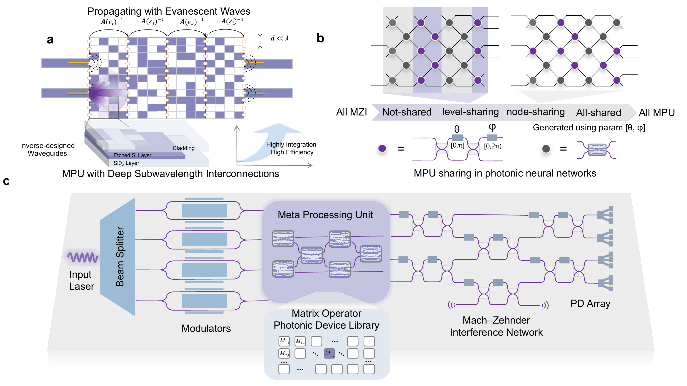
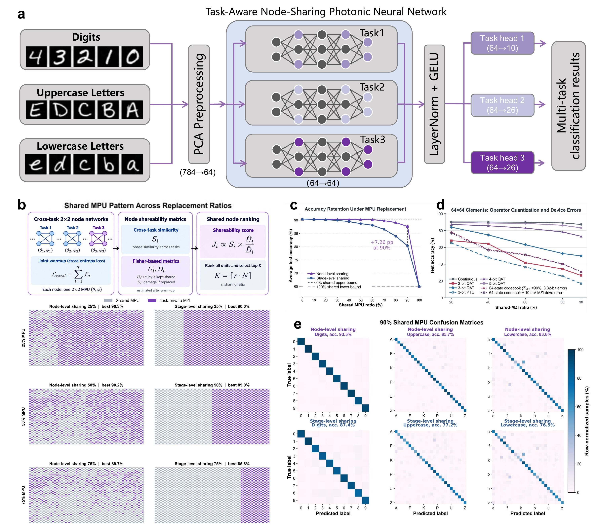

# MPU: Task-Aware Neuron-Sharing Photonic Neural Network

This work studies how a fixed, passive **meta processing unit (MPU)** can replace selected 2-to-2 MZI neurons in a multi-task photonic neural network while retaining classification accuracy. This open-source repository serves as supporting documentation for the paper “Inverse-designed meta processing units for multi-task near-field photonic computing” (submitted to *Nature Communications*).

The final setting is intentionally minimal: EMNIST ByClass is projected to 64 PCA features, passed through one complex 64-to-64 Clements mesh, detected once by square-law intensity readout, normalized by shared LayerNorm + GELU, and classified by task-specific heads.



[Figure 1 (PDF)](results/Fig1.pdf)

## Main Result

At 90% MPU sharing, the learned neuron-level replacement pattern retains substantially more multi-task accuracy than sharing a coarse layer/stage prefix.



[Figure 5 (PDF)](results/Fig5.pdf)

## Repository Layout

```text
.
├── train_mpu_pnn.py              # Core training and pattern-search algorithm
├── tools/
│   ├── download_emnist.py         # EMNIST ByClass downloader
│   ├── merge_shards.py            # Merge multi-GPU JSON shards
│   ├── plot_nature_figures.py     # Rebuild paper figures
│   ├── plot_architecture.py       # Draw network schematic
│   └── export_figure_data.py      # Export figure source data as .mat files
├── scripts/
│   ├── run_local_medium.cmd       # Small Windows sanity run
│   ├── run_main_10pct_sweep_reuse_warmup.sh
│   └── run_replicate_20pct_sweep.sh
├── data/                          # Final JSON data used for figures
├── results/                       # Publication figures
├── paper_data/                    # Figure source data in MATLAB format
└── docs/
    └── training_strategy.md       # Detailed method report
```

## Quick Start

Install dependencies:

```bash
pip install -r requirements.txt
```

Regenerate the final figures from the included JSON data:

```bash
python tools/plot_nature_figures.py
python tools/plot_architecture.py
python tools/export_figure_data.py
```

Run a compact local sanity experiment on Windows:

```powershell
scripts\run_local_medium.cmd
```

Run the full 10%-step main sweep:

```bash
bash scripts/run_main_10pct_sweep_reuse_warmup.sh
```

## Method Summary

The model first performs a 0% shared warmup, where all optical phase offsets are task-specific. The trained warmup state is then used to score each 2-to-2 photonic neuron with a Fisher/gradient-damage proxy. Neurons with small replacement damage and high cross-task agreement are selected as shared MPU candidates.

Layer-level sharing uses a coarse stage-prefix prior. Neuron-level sharing starts from the same physically meaningful stage prior and refines it by swapping individual 2-to-2 neurons, keeping the exact same MPU ratio. This isolates the benefit of fine-grained replacement.

For full equations, hyperparameters, and figure provenance, see [docs/training_strategy.md](docs/training_strategy.md).

## Citation

If you use this code, please cite the associated manuscript. A BibTeX entry will be added after publication.
